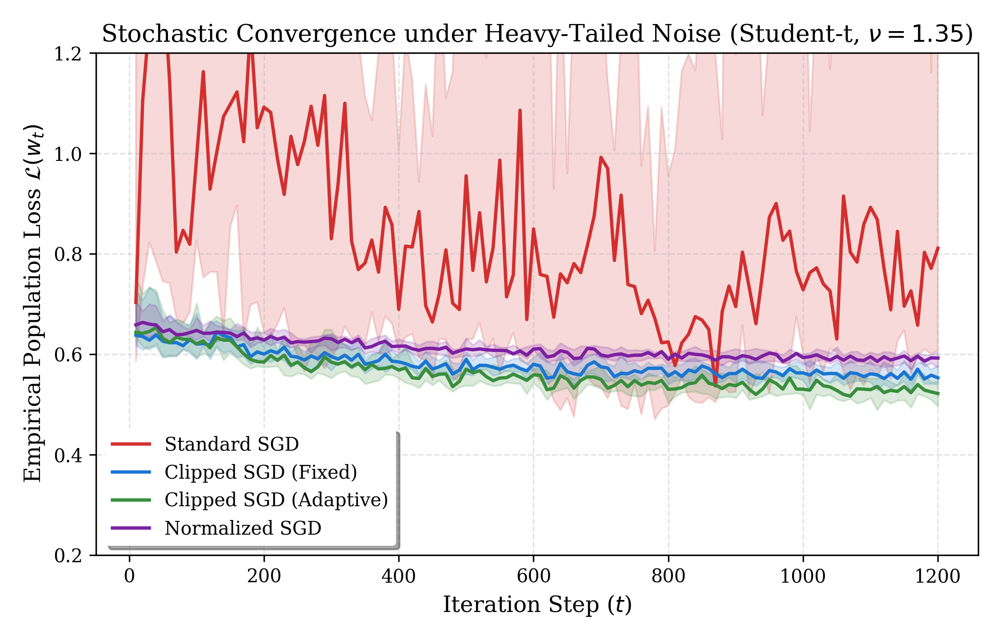
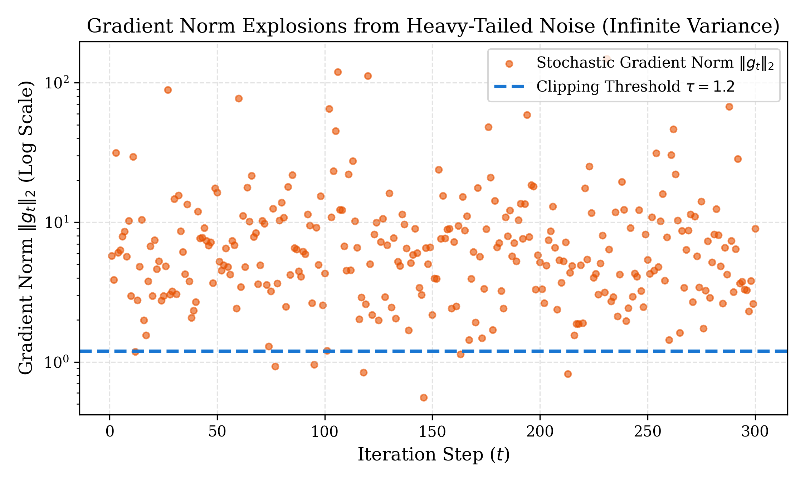
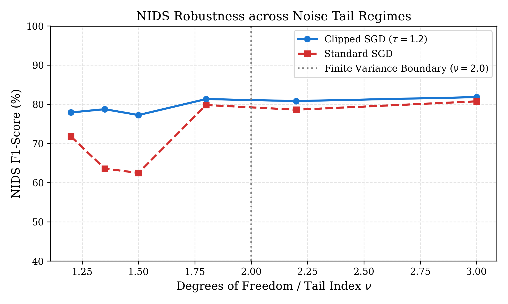
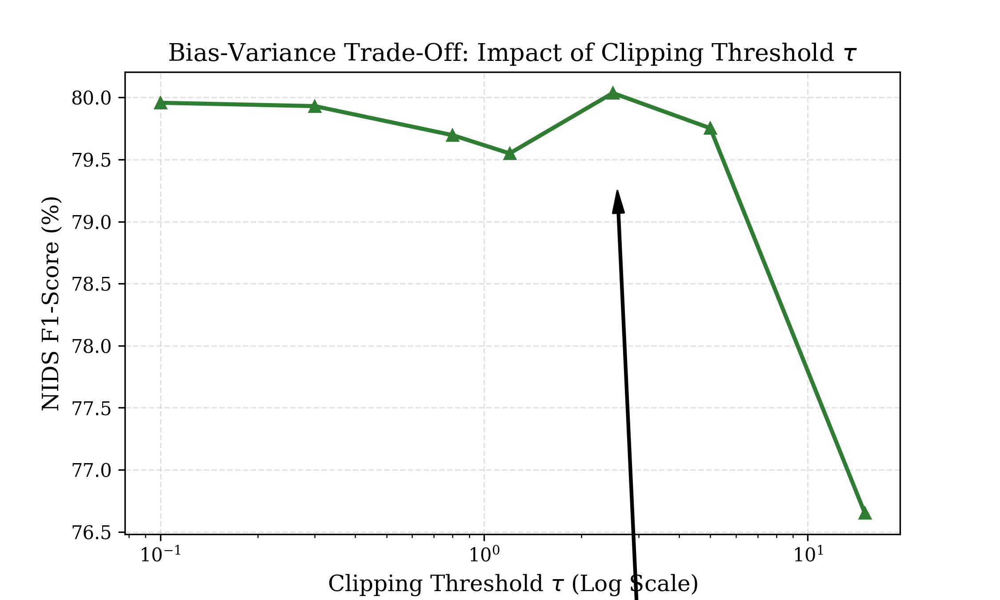

# 🔬 Robust Stochastic Optimization under Heavy-Tailed Noise for Network Telemetry

[](https://www.python.org/)
[](LICENSE)
[]()

> A benchmark study evaluating the convergence and robustness of stochastic optimization algorithms (**Standard SGD**, **Clipped SGD**, and **Normalized SGD**) under heavy-tailed noise regimes ($\nu \in (1, 2]$) applied to high-throughput network telemetry and intrusion detection.

---

## 📌 Motivation & Theoretical Context

Classical stochastic gradient optimization algorithms (such as standard SGD and Adam) rely heavily on light-tailed noise assumptions, namely:
- Bounded gradient variance: $\mathbb{E}[\|\nabla f_i(w) - \nabla f(w)\|^2] \le \sigma^2$
- Sub-Gaussian or sub-exponential tail concentration.

However, real-world cyber-physical telemetry—especially high-throughput **Network Intrusion Detection Systems (NIDS)**—naturally violates these assumptions:
1. **Bursty Traffic Dynamics:** Packet volumes, session durations, and inter-arrival intervals follow power-law / Pareto distributions.
2. **Adversarial & Volumetric Perturbations:** DDoS bursts and evasion attacks introduce massive outliers and heavy-tailed gradient noise.

When the stochastic gradient noise possesses only bounded $p$-th moments ($\mathbb{E}[\|g_t\|^p] \le G^p$ with $p \in (1, 2]$), standard SGD diverges or exhibits severe variance spikes. Conversely, **Clipped Stochastic Gradient Descent** controls the bias-variance trade-off and ensures stable convergence rates $\mathcal{O}(T^{-(p-1)/(2p-1)})$.

---

## 📊 Benchmark Findings

Empirical evaluations across 15 randomized trials on network telemetry classification under heavy-tailed Student-$t$ noise ($\nu = 1.35$, infinite variance regime):

| Optimizer | Median Final Loss | Mean F1-Score | Std Dev ($\pm\sigma$) | Behavior under Heavy Tails ($\nu = 1.35$) |
|:---|:---:|:---:|:---:|:---|
| **Standard SGD** | 0.8106 | **69.85%** | $\pm 13.49\%$ | Severe gradient explosions, high variance |
| **Normalized SGD** | 0.5920 | **79.93%** | $\pm 5.58\%$ | Scale-free, consistent |
| **Clipped SGD (Fixed $\tau=1.2$)** | 0.5527 | **80.43%** | $\pm 4.74\%$ | Bounded variance, robust convergence |
| **Clipped SGD (Adaptive $\tau_t$)** | **0.5215** | **81.01%** | **$\pm 4.17\%$** | **Optimal risk reduction, minimal variance** |

---

## 📈 Visualizations & Key Takeaways

High-resolution figures generated in `figures/`:

| Figure | Description & Takeaway |
|:---:|:---|
|  | **Convergence Trajectories under Heavy-Tailed Noise ($\nu = 1.35$)**<br><br>Loss trajectories over 1,200 iterations (15 seeds). Clipped SGD (Adaptive) achieves significantly lower empirical loss with narrow confidence intervals, whereas Standard SGD exhibits extreme variance. |
|  | **Gradient Norm Explosions & Clipping Threshold**<br><br>Log-scale stochastic gradient norm bursts. Demonstrates raw gradient explosions ($> 10^2$) and shows how the clipping threshold $\tau$ truncates destructive spikes without losing directional signal. |
|  | **Phase Transition at $\nu = 2.0$**<br><br>For $\nu \ge 2$ (finite variance), Standard SGD and Clipped SGD perform comparably. For $\nu < 2$ (infinite variance), Standard SGD drops to ~62%, while Clipped SGD retains ~80%. |
|  | **Bias-Variance Trade-Off across $\tau$**<br><br>Ablation over clipping thresholds $\tau \in [0.1, 15.0]$. Confirms an optimal operating window around $\tau^* \approx 0.8 - 2.5$ for balanced bias and variance. |

---

## 📁 Repository Structure

```text
heavy_tailed/
├── README.md                      # Project documentation and reproduction guide
├── LICENSE                        # MIT License
├── results/
│   └── benchmark_results.json     # 15-seed numerical logs
├── figures/                       # Publication-grade figures (300 DPI)
│   ├── convergence_heavy_tailed.png
│   ├── gradient_norm_bursts.png
│   ├── tail_index_sensitivity.png
│   └── clipping_threshold_ablation.png
└── src/
    ├── heavy_tailed_optimizers.py # Standard SGD, Clipped SGD, Normalized SGD
    ├── data_generator.py          # Unified data loader (synthetic Pareto & real CSV)
    ├── run_experiments.py         # Benchmark suite and metrics evaluation
    └── visualize_results.py       # High-DPI plot generation
```

---

## 🚀 Quick Start & Reproduction

### 1. Requirements
Ensure you have Python 3.10+ installed with the required scientific libraries:
```bash
pip install numpy scipy matplotlib scikit-learn pandas
```

### 2. Run Experiments (Controlled Synthetic Benchmark)
```bash
python src/run_experiments.py --seeds 15
```

### 3. Run with Your Own Real Network CSV Dataset (Optional)
You can test the exact same optimization suite on real network capture logs (e.g., CIC-IDS2017, UNSW-NB15):
```bash
python src/run_experiments.py --data path/to/network_traffic.csv --seeds 15
```

### 4. Generate Publication-Grade Figures
```bash
python src/visualize_results.py
```
Generated PNG plots are saved in `figures/` at 300 DPI.

---

## 👤 Author

- **Mossaab Belazri** ([GitHub Profile](https://github.com/mossaabbelazri))

---

## 📄 License

This project is licensed under the MIT License - see the [LICENSE](LICENSE) file for details.
